# AI Binder Navigation Decision Tree UML

This is the canonical navigation-to-page/panel/module map. Every top-level navigation item resolves into a section tree; each branch identifies the page, panel, module, submodule, or tool that owns the feature.

```mermaid
flowchart TD
  APP["🧠 AI Binder Editor"] --> NAV["🧭 Navigation"]
  NAV --> P["📁 Projects"]
  NAV --> I["🐞 Issues"]
  NAV --> C["</> Code"]
  NAV --> PR["🔀 Pull Requests"]
  NAV --> A["🤖 Agents"]
  NAV --> AC["▶️ Actions"]
  NAV --> R["🗺️ Roadmaps"]
  NAV --> S["🛡️ Security"]
  NAV --> IN["📈 Insights"]
  NAV --> REL["🚀 Releases"]
  NAV --> E["🖥️ Environments"]
  NAV --> B["🧩 Blueprints"]
  NAV --> EX["🧩 Extensions"]
  NAV --> T["▣ Terminal"]
  NAV --> M["🧠 Memory"]
  NAV --> G["◉ GitHub"]

  P --> P1["📊 Dashboard"] & P2["🗂️ Workspace"] & P3["☑️ Tasks"] & P4["⚙️ Jobs"] & P5["🔨 Builds"] & P6["🧪 Tests"]
  P2 --> P21["📂 Folders"] & P22["📄 Documents"] & P23["🏷️ Tags"]
  I --> I1["📋 Issue Board"] & I2["🔎 Issue Detail"] & I3["🚦 Triage"]
  I2 --> I21["💬 Comments"] & I22["🔗 Linked Work"] & I23["✓ Verification"]
  C --> C1["⌨️ Code Editor"] & C2["📄 Source"] & C3["🧪 Tests"] & C4["📦 Artifacts"] & C5["🧠 BrainScript"]
  C1 --> C11["📄 Files"] & C12["☷ Outline"] & C13["⚠️ Problems"] & C14["▣ Terminal"]
  C5 --> C51["⌘ Script Editor"] & C52["🧩 Modules"] & C53["🔁 Workflows"]
  PR --> PR1["📋 List"] & PR2["👁️ Review"] & PR3["🔗 Merge"]
  PR2 --> PR21["± Diff"] & PR22["💬 Comments"] & PR23["✓ Checks"]
  A --> A1["📒 Registry"] & A2["👥 Employees"] & A3["👥 Teams"] & A4["🔐 Permissions"] & A5["🛠️ Tools"] & A6["🧠 Memory"] & A7["⚙️ Jobs"] & A8["✓ Verification"]
  AC --> AC1["🔁 Workflows"] & AC2["⚙️ Jobs"] & AC3["▶️ Runs"] & AC4["📜 Logs"] & AC5["📦 Artifacts"]
  R --> R1["🏁 Milestones"] & R2["🔗 Dependencies"] & R3["📅 Timeline"] & R4["✨ Features"]
  S --> S1["🔐 Permissions"] & S2["🔑 Secrets"] & S3["📜 Audit"] & S4["🧾 Provenance"] & S5["🧱 Sandbox"] & S6["✓ Verification"]
  IN --> IN1["📊 Dashboard"] & IN2["❤️ Health"] & IN3["📈 Metrics"] & IN4["🧾 Provenance"] & IN5["🧠 Memory"] & IN6["📜 Audit"]
  REL --> REL1["📋 Releases"] & REL2["📡 Channels"] & REL3["✓ Checks"] & REL4["📦 Packages"] & REL5["🔢 Checksums"]
  E --> E1["💻 Local"] & E2["🟢 Node"] & E3["📱 Android"] & E4["🖥️ Desktop"] & E5["🧰 Toolchains"]
  B --> B1["🧠 Program Studio"] & B2["🔷 UML"] & B3["🔀 Flowchart"] & B4["🏗️ Architecture"] & B5["🗄️ Data Model"] & B6["🔌 API Design"] & B7["🖼️ UI Wireframe"] & B8["📝 Whiteboard"] & B9["🌳 Decision Tree"] & B10["🧩 Module Map"]
  B1 --> B11["</> Code"] & B12["▦ Program Canvas"] & B13["📝 Whiteboard"] & B14["📑 Draft Pages"]
  B2 --> B21["▦ Class"] & B22["◎ Use Case"] & B23["⇢ Sequence"] & B24["↯ Activity"] & B25["◈ State"]
  EX --> EX1["🔌 Plugins"] & EX2["🧰 SDK"] & EX3["🔎 Search"] & EX4["∑ Math"] & EX5["☁️ Providers"] & EX6["🔑 Credentials"]
  T --> T1["⌘ Console"] & T2[">_ Commands"] & T3["⚙️ Jobs"] & T4["🧱 Sandbox"] & T5["📜 Logs"]
  M --> M1["💬 Conversation"] & M2["📁 Project"] & M3["🤖 Agent"] & M4["🔎 Retrieval"] & M5["🗂️ Index"]
  G --> G1["📦 Repositories"] & G2["🐞 Issues"] & G3["🔀 Pull Requests"] & G4["▶️ Actions"] & G5["🌿 Branches"] & G6["🧾 Commits"] & G7["⚙️ Settings"]
```

## Routing rule

`Navigation Item → Section Tree → Page → Panel/Sub-panel → Module/Sub-module → Tool → Action → Verification → Artifact`

A selected node becomes the active editor context. The node ID is stable and can be persisted with the binder page/document.

## Module ownership

- Projects → `workspace.platform`, `development.pipeline`
- Issues → `workspace.platform`, `verification.loop`
- Code → `development.pipeline`, `brainscript.runtime`
- Pull Requests → `integrations.gateway`, `verification.loop`
- Agents → `agents.runtime`, `tools.catalog`, `memory.system`
- Actions → `workforce.orchestration`, `development.pipeline`
- Roadmaps → `core.lifecycle`, `workspace.platform`
- Security → `security.policy`, `verification.loop`
- Insights → `runtime.observability`, `memory.system`
- Releases → `packaging.release`, `verification.loop`
- Environments → `runtime.observability`, `packaging.release`
- Blueprints → `binder.platform`, `brainscript.runtime`
- Extensions → `plugins.runtime`, `tools.catalog`, `integrations.gateway`
- Terminal → `development.pipeline`, `security.policy`
- Memory → `memory.system`
- GitHub → `integrations.gateway`

## Decision behavior

1. Click a navigation item.
2. Load its decision-tree root.
3. Expand page branches.
4. Select a page/panel/module/submodule/tool.
5. Route the editor context to that node.
6. Load its owning module.
7. Apply module permissions and configuration.
8. Run verification before activation where required.
9. Display the page and its child panels.
10. Persist the selected navigation node with the binder workspace.
